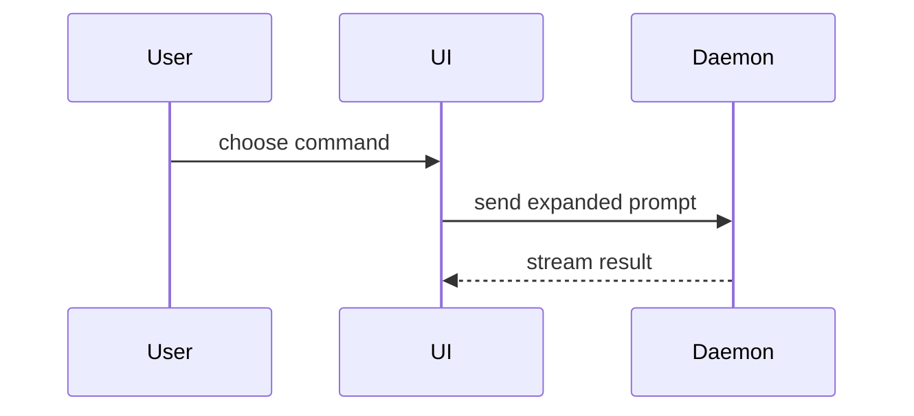

<!-- Source: mattpocock/skills (https://github.com/mattpocock/skills), skills/in-progress/pr/SKILL.md @ c55ee46073 (2026-09-18), MIT. See ../THIRD_PARTY.md. Modified: rewritten to fill `.github/pull_request_template.md`'s own fields, no longer a separate template of its own. -->

Fill `.github/pull_request_template.md`'s fields with this guidance; this skill is not a template of its own. Skip all preambles and keep prose brief. Use the user's domain language from `CONTEXT.md`.

## `Before:` / `After:` / the one-sentence summary

Pick the smallest view that makes the key point clear. A screenshot, a short description, or one of the sketches below can fill `Before:` and `After:`; add the one-sentence summary only when the change isn't obvious from them.

- Show logic or an algorithm as pseudocode:

```text
on(save)
  if content is unchanged
    return cached result
  write new content
  return fresh result
```

- Show runtime control flow as a call tree:

```text
submitForm
  createSession
    persistPrompt
    launchAgent
  navigateToSession
```

- Show UI structure as a component tree, including state and module boundaries that matter:

```tsx
<SessionPage>(apps / example / src / routes / session.tsx);
useSessionEvents() < SessionToolbar > <RunSkillButton>(packages / ui);
```

- Show file responsibility or a broad refactor as a shallow file tree:

```text
src/
├── commands/       # parses user actions
├── sessions/       # owns session state
└── transport/      # sends API requests
```

- Show component interaction, control flow, or data flow with Mermaid:



- Use `diff` when the point is what changes and the surrounding shape already exists. Match the diff shape to the topic.

For a component change:

```diff
 <SessionPage>
   useSessionEvents()
   <SessionToolbar>
+    <RunSkillButton />
   <SessionTimeline>
+    <SkillResultCard />
```

For a file-layout change:

```diff
 src/
 ├── commands/
+│   └── show-me.ts       # expands the slash command
 ├── sessions/
-└── transport.ts
+└── transport/
+    ├── client.ts
+    └── stream.ts
```

For a call-tree or call-stack change:

```diff
 submitForm
   createSession
     persistPrompt
+    expandSkillMention
     launchAgent
-  navigateToSession
+  navigateToSession
+    subscribeToEvents
```

For a state or control-flow change:

```diff
 on(save)
-  write content
+  if content is unchanged
+    return cached result
+  write new content
+  invalidate cache
```

- Show the whole block when most of it is new, when omitted context would hide ownership or order, or when the user needs a copyable target shape:

```ts
function expandSkill(command: string): string {
  const skillName = command.slice(1);
  return `use the ${skillName} skill`;
}
```

### Guidance

Place each visual next to the short text it supports. Keep only the calls, files, props, states, and boundaries needed to answer the reviewer's likely question.

You may use one of these, you may use several, it is unlikely you will use all of them. Use your judgement and don't overwhelm the reviewer.

## `Evidence:`

Fill `Evidence:` with the template's own definition: the command that went red before the change and green after, pasted with its real result, not pseudocode. For a guard test, add the run with the guard removed. For a fix to a finding or bug, name the other members of its class this PR checked, and the source that list came from.

Add a screenshot alongside when the change is visual and the environment is set up for it; it supplements the pasted result, it doesn't replace it.
